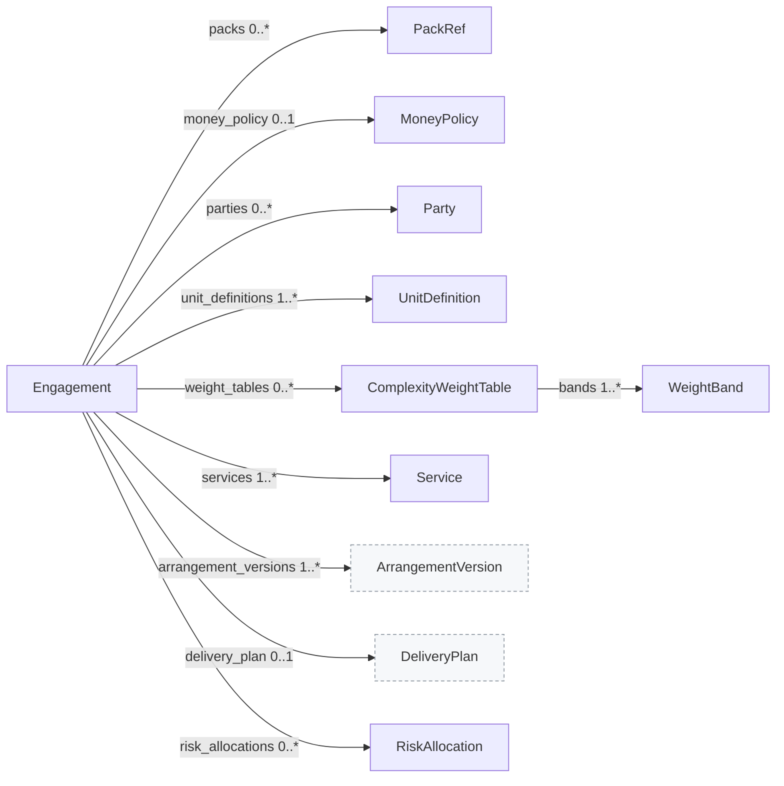
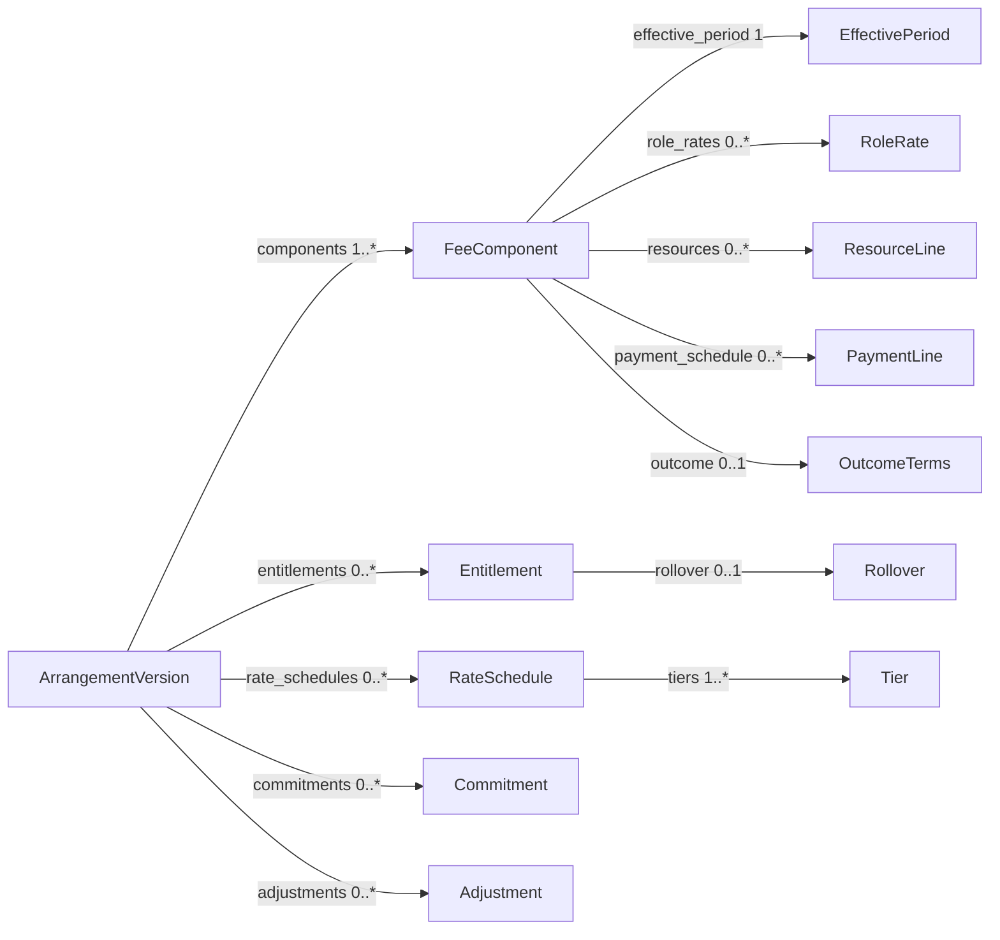
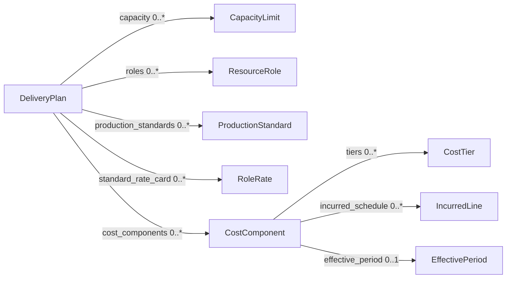
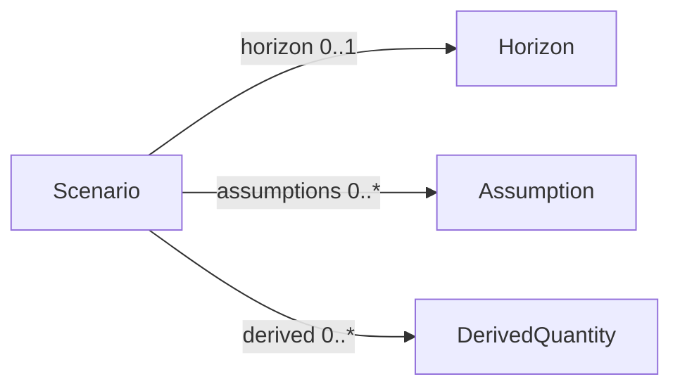

<!-- Generated by `cometric ontology --out docs/ontology`. Do not edit by hand. -->

# Cometric ontology

Cometric's ontology has three layers, all generated from the package so they match what the engine accepts:

1. **Core model** ([core.md](core.md)): the classes and fields of an engagement, a scenario, and a cost policy. These are OWL classes and properties.
2. **Core vocabularies** ([core.md#core-vocabularies](core.md#core-vocabularies)): the controlled values the engine executes, such as billing bases, calculation methods, accumulation periods, and evidence classes. These are SKOS concept schemes.
3. **Packs**: domain knowledge as SKOS concept schemes, plus overlays, rules, claims, and sources. A pack can extend another and qualify its concepts with overlays.

## Files

| File | Contents |
|---|---|
| [cometric.ttl](cometric.ttl) | The whole ontology in Turtle (RDF): OWL for the core model, SKOS for vocabularies and packs, rules and evidence as typed resources. |
| [core.md](core.md) | Core classes, fields, and vocabularies. |
| [pack-alsp.md](pack-alsp.md) | Alternative legal services. |
| [pack-base.md](pack-base.md) | Base commercial knowledge. |
| [pack-consulting.md](pack-consulting.md) | Consulting and advisory services. |

## Packs

| Pack | Version | Extends | Concept schemes | Concepts | Overlays | Rules | Claims | Sources |
|---|---|---|---|---|---|---|---|---|
| [alsp](pack-alsp.md) | 0.1.0 | base | 4 | 21 | 52 | 16 | 48 | 25 |
| [base](pack-base.md) | 0.2.0 |  | 16 | 330 | 0 | 33 | 52 | 14 |
| [consulting](pack-consulting.md) | 0.1.0 | base | 4 | 21 | 8 | 3 | 0 | 0 |

## Core model

One diagram per aggregate, showing what each object contains, then a table of the references by id between objects. Labels give the field and its cardinality. Grey dashed boxes are drawn in full in another diagram. `CostPolicy` and `TolerancePolicy` are flat (see [core.md](core.md)).

### Engagement



### Arrangement version



### Delivery plan and costs



### Scenario



### References by id

These fields hold another object's id rather than the object itself.

| From | Field | To | Cardinality |
|---|---|---|---|
| [Service](core.md#service) | `unit_definition_id` | [UnitDefinition](core.md#unitdefinition) | 1 |
| [ArrangementVersion](core.md#arrangementversion) | `supersedes_id` | [ArrangementVersion](core.md#arrangementversion) | 0..1 |
| [FeeComponent](core.md#feecomponent) | `service_id` | [Service](core.md#service) | 1 |
| [FeeComponent](core.md#feecomponent) | `depends_on` | [FeeComponent](core.md#feecomponent) (Components or entitlements of the same version) | 0..* |
| [FeeComponent](core.md#feecomponent) | `rate_schedule_id` | [RateSchedule](core.md#rateschedule) | 0..1 |
| [FeeComponent](core.md#feecomponent) | `entitlement_id` | [Entitlement](core.md#entitlement) | 0..1 |
| [FeeComponent](core.md#feecomponent) | `weight_table_id` | [ComplexityWeightTable](core.md#complexityweighttable) | 0..1 |
| [Entitlement](core.md#entitlement) | `granted_by` | [FeeComponent](core.md#feecomponent) | 1 |
| [Commitment](core.md#commitment) | `component_ids` | [FeeComponent](core.md#feecomponent) | 0..* |
| [Commitment](core.md#commitment) | `service_id` | [Service](core.md#service) | 0..1 |
| [Adjustment](core.md#adjustment) | `applies_to` | [FeeComponent](core.md#feecomponent) | 0..* |
| [Adjustment](core.md#adjustment) | `component_id` | [FeeComponent](core.md#feecomponent) | 0..1 |
| [Adjustment](core.md#adjustment) | `outside_rate_schedule_id` | [RateSchedule](core.md#rateschedule) | 0..1 |
| [CapacityLimit](core.md#capacitylimit) | `overflow_replaces` | [CostComponent](core.md#costcomponent) | 0..* |

### Classes

| Class | Meaning |
|---|---|
| [Engagement](core.md#engagement) | An evaluated client-provider relationship: parties, services, effective-dated arrangement versions, and an optional delivery plan. |
| [Scenario](core.md#scenario) | A time-indexed set of assumptions that one or more arrangements are evaluated against. |
| [CostPolicy](core.md#costpolicy) | Mapping from cost category to margin layer, plus the transition-cost view. |
| [TolerancePolicy](core.md#tolerancepolicy) | Relative deviations treated as adverse when deriving who bears risk. |
| [PackRef](core.md#packref) | A domain pack the engagement declares, optionally pinned to a version. |
| [MoneyPolicy](core.md#moneypolicy) | Rounding mode, scale, and level for money amounts. |
| [Party](core.md#party) | A contract party: client, provider, or subcontractor. |
| [UnitDefinition](core.md#unitdefinition) | An unambiguous measurable unit of work, with its counting and acceptance rules. |
| [ComplexityWeightTable](core.md#complexityweighttable) | Conversion from raw units to weighted units by complexity band. |
| [Service](core.md#service) | A defined operational obligation, priced in one unit. |
| [ArrangementVersion](core.md#arrangementversion) | An effective-dated commercial configuration: fee components, entitlements, rate schedules, commitments, and adjustments. |
| [DeliveryPlan](core.md#deliveryplan) | How work is produced. Drives cost and capacity, not contractual fee. |
| [RiskAllocation](core.md#riskallocation) | An identified exposure and the party declared to bear it. |
| [Horizon](core.md#horizon) | The months a scenario covers. |
| [Assumption](core.md#assumption) | A scenario quantity. `value` is the TOTAL for `time_period`, not a per-month rate. |
| [DerivedQuantity](core.md#derivedquantity) | A quantity computed each month from other quantities, e.g. billable units after a counting rule. |
| [WeightBand](core.md#weightband) | One complexity band of a weight table and its weight. |
| [FeeComponent](core.md#feecomponent) | One charge computed by one calculation method. |
| [Entitlement](core.md#entitlement) | What a base fee or commitment purchases: an included quantity of a unit per period. |
| [RateSchedule](core.md#rateschedule) | Rates and tiers for one unit, with a tier method, tier scope, and accumulation period. |
| [Commitment](core.md#commitment) | A minimum spend, minimum volume, reserved capacity, or prepaid credit, tested over a period with a shortfall rule. |
| [Adjustment](core.md#adjustment) | A mechanism that modifies a named subtotal at a declared evaluation step: discount, rebate, collar, service credit, holdback, bonus, cap, or indexation. |
| [CapacityLimit](core.md#capacitylimit) | A limit on a quantity per period, with the cost of overflow when it is exceeded. |
| [ResourceRole](core.md#resourcerole) | A staffing role with its FTE, available hours, productive ratio, and safe utilization ceiling. |
| [ProductionStandard](core.md#productionstandard) | Effort per unit of output, converting demand quantities to demand hours. |
| [RoleRate](core.md#rolerate) | An hourly rate for one role. |
| [CostComponent](core.md#costcomponent) | A direct or allocated cost, classified into a margin layer by the cost policy. |
| [EffectivePeriod](core.md#effectiveperiod) | The date range in which a fee component or cost component applies. |
| [ResourceLine](core.md#resourceline) | Dedicated staffing priced per FTE-month. |
| [PaymentLine](core.md#paymentline) | One scheduled payment of a project fee. |
| [OutcomeTerms](core.md#outcometerms) | Terms for OUTCOME_ADJUSTMENT components (spec 4.1; report RULE-003, RULE-004). |
| [Rollover](core.md#rollover) | What happens to unused entitlement at the end of its period. |
| [Tier](core.md#tier) | One band of a rate schedule: lower bound, optional upper bound, and rate. |
| [CostTier](core.md#costtier) | One band of a tiered variable cost. |
| [IncurredLine](core.md#incurredline) | One month's incurred amount of a one-time cost. |

## Core vocabularies

| Vocabulary | Values |
|---|---|
| [AccumulationPeriod](core.md#accumulationperiod) | `MONTH`, `QUARTER`, `YEAR`, `CONTRACT_YEAR`, `TERM` |
| [AdjustmentType](core.md#adjustmenttype) | `DISCOUNT`, `REBATE`, `COLLAR`, `SLA_CREDIT`, `HOLDBACK`, `BONUS`, `CAP`, `INDEXATION` |
| [AggregationScope](core.md#aggregationscope) | `COMPONENT`, `SERVICE`, `ENGAGEMENT` |
| [AssumptionBasis](core.md#assumptionbasis) | `TOTAL`, `RATE` |
| [Avoidability](core.md#avoidability) | `AVOIDABLE`, `UNAVOIDABLE`, `UNKNOWN` |
| [BillingBasis](core.md#billingbasis) | `TIME`, `RESOURCE`, `CAPACITY`, `OUTPUT`, `USAGE`, `FIXED`, `COST`, `OUTCOME` |
| [BreachMode](core.md#breachmode) | `OVERFLOW_COST`, `BACKLOG`, `INFEASIBLE` |
| [CalculationMethod](core.md#calculationmethod) | `FIXED_RECURRING`, `TIME`, `DEDICATED_RESOURCE`, `UNIT_OUTPUT`, `WEIGHTED_UNIT_OUTPUT`, `ALLOWANCE_OVERAGE`, `FIXED_PROJECT`, `COST_PLUS`, `OUTCOME_ADJUSTMENT` |
| [ChargeCadence](core.md#chargecadence) | `ONE_TIME`, `MONTHLY`, `QUARTERLY`, `ANNUAL`, `EVENT`, `USAGE_TRIGGERED` |
| [ClassificationAuthority](core.md#classificationauthority) | `PROVIDER`, `CLIENT`, `JOINT` |
| [CommitmentKind](core.md#commitmentkind) | `MINIMUM_SPEND`, `MINIMUM_VOLUME`, `RESERVED_CAPACITY`, `PREPAID_CREDIT` |
| [CostBehavior](core.md#costbehavior) | `FIXED`, `VARIABLE`, `STEP`, `TIERED_VARIABLE`, `ONE_TIME` |
| [CostCategory](core.md#costcategory) | `DEDICATED_LABOR`, `POOLED_LABOR`, `DELIVERY_MANAGEMENT`, `QA_REWORK`, `AI_INFERENCE`, `PLATFORM_OPERATIONS`, `THIRD_PARTY`, `CLIENT_IMPLEMENTATION`, `REUSABLE_ENGINEERING`, `TRANSITION`, `ENGAGEMENT_OVERHEAD`, `IDLE_POOLED_CAPACITY`, `CORPORATE_OVERHEAD` |
| [CostPeriod](core.md#costperiod) | `MONTHLY`, `ANNUAL`, `TERM` |
| [DerivedRounding](core.md#derivedrounding) | `NONE`, `HALF_UP`, `DOWN`, `UP` |
| [Distribution](core.md#distribution) | `FLAT`, `PROFILE` |
| [EvidenceClass](core.md#evidenceclass) | `A_DIRECT`, `B_CORROBORATED`, `C_INFERENCE`, `D_PROPOSED` |
| [MarginLayer](core.md#marginlayer) | `DIRECT_DELIVERY`, `ENGAGEMENT_AVOIDABLE`, `PORTFOLIO_SHARED`, `CORPORATE_OVERHEAD` |
| [Origin](core.md#origin) | `OBSERVED`, `CONTRACTED`, `ESTIMATED`, `ILLUSTRATIVE`, `INTERNAL_POLICY` |
| [OutcomeDirection](core.md#outcomedirection) | `HIGHER_IS_BETTER`, `LOWER_IS_BETTER` |
| [OutcomeForm](core.md#outcomeform) | `SHARE`, `SUCCESS`, `PERCENT_OF_OUTCOME` |
| [PartyRole](core.md#partyrole) | `CLIENT`, `PROVIDER`, `SUBCONTRACTOR` |
| [Prevalence](core.md#prevalence) | `ESTABLISHED_COMMON`, `DOCUMENTED_SPECIALIZED`, `EMERGING`, `UNVERIFIED` |
| [ProrationPolicy](core.md#prorationpolicy) | `CALENDAR_DAYS`, `FULL_MONTH_FROM_NEXT`, `FULL_MONTH_FROM_CURRENT` |
| [Recognition](core.md#recognition) | `CUMULATIVE`, `PERIOD_END`, `PER_SEGMENT` |
| [RiskBearer](core.md#riskbearer) | `CLIENT`, `PROVIDER`, `SHARED`, `THIRD_PARTY`, `NONE_ADVERSE` |
| [RolloverPolicy](core.md#rolloverpolicy) | `NONE`, `NEXT_PERIOD`, `TERM` |
| [RoundingLevel](core.md#roundinglevel) | `LINE_ITEM`, `PERIOD_TOTAL` |
| [RoundingMode](core.md#roundingmode) | `HALF_UP`, `HALF_EVEN` |
| [Severity](core.md#severity) | `INFO`, `WARNING`, `APPROVAL_REQUIRED`, `ERROR` |
| [ShortfallRule](core.md#shortfallrule) | `PERIOD_END_TRUE_UP`, `PER_SEGMENT` |
| [TerminationRule](core.md#terminationrule) | `PRORATE`, `REMAINDER_DUE`, `WAIVED` |
| [TestedAgainst](core.md#testedagainst) | `GROSS`, `NET_OF_DISCOUNTS`, `NET_OF_CREDITS` |
| [ThresholdScope](core.md#thresholdscope) | `EXCESS_ONLY`, `ENTIRE_SUBTOTAL` |
| [TierMethod](core.md#tiermethod) | `MARGINAL`, `ALL_UNITS`, `GRADUATED_BLOCK` |
| [TierScope](core.md#tierscope) | `ALL_ELIGIBLE`, `EXCESS_ONLY` |
| [Topology](core.md#topology) | `DEDICATED`, `POOLED`, `HYBRID` |
| [TransitionView](core.md#transitionview) | `INCURRED`, `AMORTIZED` |
| [UnitKind](core.md#unitkind) | `COUNT`, `WEIGHTED`, `HOURS`, `FTE_MONTHS`, `METER` |

## Glossary

| Term | Definition |
|---|---|
| `contractual_fee` | Contractual consideration computed under the arrangement for a period. Not recognized revenue. |
| `gross_profit` | contractual_fee minus DIRECT_DELIVERY costs. |
| `contribution_profit` | gross_profit minus ENGAGEMENT_AVOIDABLE costs. Layers partition costs, so nothing is subtracted twice. |
| `margin` | (price - cost) / price. Not the same as markup, (price - cost) / cost. |
| `accumulation_period` | The period over which an allowance, minimum, tier counter, or capacity limit accumulates: MONTH, QUARTER, YEAR, CONTRACT_YEAR, TERM. |
| `recognition` | When an accumulated effect is charged: CUMULATIVE (the month the threshold is crossed), PERIOD_END (true-up in the final month), PER_SEGMENT (monthly only). |
| `margin_layer` | DIRECT_DELIVERY, ENGAGEMENT_AVOIDABLE, PORTFOLIO_SHARED, CORPORATE_OVERHEAD. A cost policy maps every cost category to exactly one layer. |
| `cost_policy` | Mapping from cost category to margin layer plus the transition-cost view. 'reference' is shipped and must be named explicitly. |
| `dominance` | Candidate X dominates Y when X is at least as good on every comparison metric and strictly better on one. |
| `derived_bearer` | Who absorbs a deviation from the base scenario: PROVIDER (contribution falls), CLIENT (unit price rises), SHARED, or NONE_ADVERSE. |
| `realization` | contractual_fee / standard_value, where standard_value is hours worked at the delivery plan's standard rate card. Below 1 is a write-down. |
| `outcome_fee` | Fee from an OUTCOME_ADJUSTMENT component, measured over its accumulation period and charged at period end: SHARE of improvement against a baseline, SUCCESS amount at a target, or PERCENT_OF_OUTCOME. Needs attribution, a cap, and recorded approval. |
| `price_floor` | (DIRECT_DELIVERY + ENGAGEMENT_AVOIDABLE costs + risk premium) / (1 - target margin). A decision formula, not a benchmark. |
| `evidence_class` | A_DIRECT, B_CORROBORATED, C_INFERENCE, D_PROPOSED. Independent of prevalence. |
| `origin` | Every assumption is OBSERVED, CONTRACTED, ESTIMATED, ILLUSTRATIVE, or INTERNAL_POLICY. |

## Using the Turtle file

Namespaces:

| Prefix | Namespace | Holds |
|---|---|---|
| `cm:` | `https://github.com/mfbaig35r/cometric/ontology/core#` | Core classes (`cm:FeeComponent`), their fields (`cm:FeeComponent.billing_basis`), and the terms used to describe packs (`cm:Rule`, `cm:evidenceClass`). |
| `cmv:` | `https://github.com/mfbaig35r/cometric/ontology/vocab#` | Core vocabularies (`cmv:BillingBasis`) and their values (`cmv:BillingBasis.OUTPUT`), and the glossary. |
| `pack-alsp:` | `https://github.com/mfbaig35r/cometric/ontology/pack/alsp#` | Concepts, schemes, overlays, rules, claims, and sources of the alsp pack. |
| `pack-base:` | `https://github.com/mfbaig35r/cometric/ontology/pack/base#` | Concepts, schemes, overlays, rules, claims, and sources of the base pack. |
| `pack-consulting:` | `https://github.com/mfbaig35r/cometric/ontology/pack/consulting#` | Concepts, schemes, overlays, rules, claims, and sources of the consulting pack. |

The IRIs are identifiers; they are not served as web pages.

Example: every pack concept that maps to the OUTPUT billing basis, with its evidence class.

```python
import rdflib

g = rdflib.Graph().parse("docs/ontology/cometric.ttl")
rows = g.query("""
PREFIX skos: <http://www.w3.org/2004/02/skos/core#>
PREFIX cm: <https://github.com/mfbaig35r/cometric/ontology/core#>
PREFIX cmv: <https://github.com/mfbaig35r/cometric/ontology/vocab#>
SELECT ?id ?label ?evidence WHERE {
  ?c skos:notation ?id ; skos:prefLabel ?label ;
     cm:billingBasis cmv:BillingBasis.OUTPUT ; cm:evidenceClass ?evidence .
} ORDER BY ?id
""")
```

The same knowledge is available at run time through the MCP server (`lookup_concept`, `list_vocabulary`, `describe_pack`, `list_applicable_evidence`) and the CLI (`cometric lookup`, `cometric packs`).
